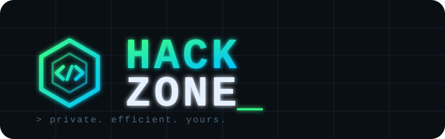

# Hack-Zone
Creating Efficient and Private Software to Bring Control to your System.

This repo serves as a portal to easily access all of the software that I have been vibecoding with AI. Nearly all of the software I am creating here is under the Unlicense, so feel free to do what you wish with it. I hope someone finds some use out of an app of mine, but ultimately this is for my fun and for my use. Most of these apps exist because of my grievances with modern software.

I may update this note later, but every line after this one is written by AI. Enjoy!

  

## What all of these projects have in common

- Every project is a public repository under [Doggydoggywhatnow](https://github.com/Doggydoggywhatnow), and you can read, download and build all of it for free.
- Every project is vibecoded: written with AI, for the fun and personal use of its creator.
- Every project exists because of a grievance with modern software, and aims to be a smaller, more focused alternative.
- None of them requires an account, subscription or payment to use.

Licensing is not identical everywhere: most projects are under the Unlicense, but PersonaliDy keeps iD's ISC license because it is a fork.

## Projects

| Project | Goal of the software |
|:--|:--|
| [8tris](https://github.com/Doggydoggywhatnow/8tris) | A minimal, endlessly customizable Tetris as one small native program: any board size, custom pieces, themes, sounds, keys and pace. |
| [Adderall](https://github.com/Doggydoggywhatnow/Adderall) | A grid-based habit tracker written in C: one row of cells per habit, one cell per day, stored locally with no accounts or subscriptions. |
| [Exhaust](https://github.com/Doggydoggywhatnow/Exhaust) | A private, native notepad aiming for feature parity with Obsidian: plain Markdown notes, journals, knowledge bases and project plans linked together, with no network, telemetry or accounts by default. |
| [lib-Peep](https://github.com/Doggydoggywhatnow/lib-Peep) | "Liberated Peep": Peep's playback kernel as a tiny assembly library (WAV and FLAC decoding for x86-64 and ARM64) that any program able to call C can use. |
| [Peep](https://github.com/Doggydoggywhatnow/Peep) | A minimalist music player that is just a screen: the album cover is the whole interface. Written in x86-64 assembly, with no network code, telemetry or library database. |
| [PersonaliDy](https://github.com/Doggydoggywhatnow/PersonaliDy) | A fork of the OpenStreetMap iD editor that adds power-mapping features for experienced users: rapid node placement, quickdraw, zoom preferences and Node2Area. |
| [THC](https://github.com/Doggydoggywhatnow/THC) | A lightweight multimedia player written in C for the music and videos you already own, with a streaming-service-style browsing and watch-history experience but no accounts or uploads. |
